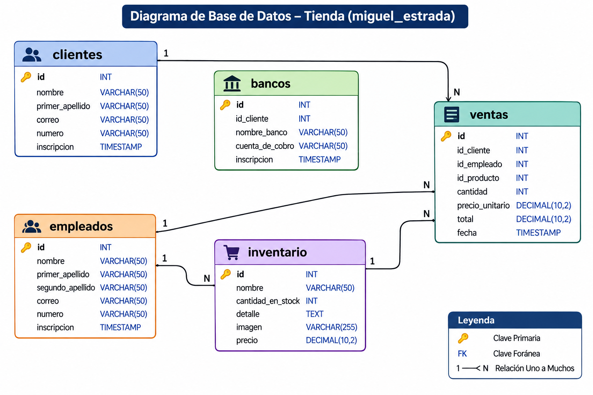

# Diagrama de Base de Datos

## Descripción

Este proyecto contiene el diagrama de una base de datos diseñada para
gestionar clientes, bancos, empleados, inventario y ventas.

El diagrama representa las tablas, sus principales campos y las
relaciones entre ellas.

## Estructura de la base de datos

La base de datos está compuesta por cinco tablas:

  -----------------------------------------------------------------------
  Tabla                               Descripción
  ----------------------------------- -----------------------------------
  `clientes`                          Almacena la información de los
                                      clientes.

  `bancos`                            Registra la información bancaria
                                      asociada a cada cliente.

  `empleados`                         Almacena los datos de los
                                      empleados.

  `inventario`                        Contiene los productos disponibles,
                                      sus cantidades y precios.

  `ventas`                            Registra las ventas realizadas.
  -----------------------------------------------------------------------

## Relaciones

-   **Clientes - Bancos:** Un cliente puede tener varios registros
    bancarios.
-   **Clientes - Ventas:** Un cliente puede realizar varias compras.
-   **Empleados - Ventas:** Un empleado puede registrar varias ventas.
-   **Inventario - Ventas:** Un producto puede aparecer en diferentes
    ventas.

## Diagrama

> Reemplaza `database-diagram.png` por el nombre del archivo de imagen
> que contiene tu diagrama.

## Tecnologías

-   SQL
-   Bases de datos relacionales
-   Diagramas entidad-relación (ERD)

## Objetivo

Representar visualmente la estructura de la base de datos para facilitar
la comprensión de sus tablas, campos y relaciones, así como apoyar su
desarrollo y mantenimiento.
